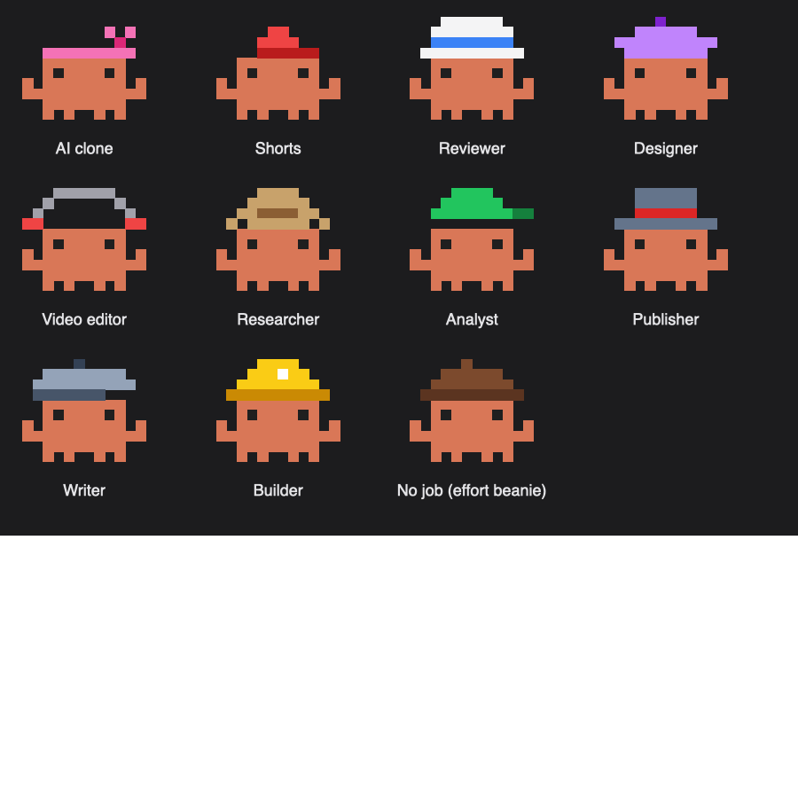

# Mission Control

A Claude Code mod that shows what Claude is doing, in this chat and every other one.

- **Progress bar above the prompt:** the chat's task list as a sparkly bar with a "Tasks 2/4" pill, and a pixel crab whose hat shows the effort level.
- **Agents pane** (`/helpers`): every helper agent with its job, model, effort, tokens, rough cost and time. Crabs wear a hat for their job: researcher, writer, designer, video editor, builder, analyst, reviewer and more.
- **All chats pane** (`/chats`): every open chat, numbered, grouped into 🟠 Waiting on you, 🔵 Running, 🔴 No signal, ✅ Finished and ⚪ Open. Click a chat's name to open it; clear finished ones with ✕ or Clear all.
- **Background jobs:** a chat that leaves a render or encode running stays under Running until it finishes.

Costs are rough API-price estimates, a yardstick only. The All chats pane reads chat names from the Claude desktop app on macOS; elsewhere it uses each chat's first message.

## Your own hats

Crabs pick a hat from words in the helper's task. To add your own words or rename a job, create `~/.claude/mission-control/hats.json`:

```json
{
  "clone": { "role": "My Twin", "words": ["mytwin"] },
  "design": { "words": ["figma"] }
}
```

Jobs: `clone`, `shorts`, `review`, `design`, `video`, `research`, `data`, `publish`, `write`, `build`. Words listed there are checked first. Or just ask Claude to change the hats for you.



## Install

At the prompt of a Claude Code terminal session:

```
/plugin install mission-control --marketplace sjconsidine/mission-control
```

From a shell:

```
claude plugin install mission-control --marketplace sjconsidine/mission-control
```

In the desktop app, where `/plugin` does not run: click + next to the prompt box, then Plugins, Add marketplace with `sjconsidine/mission-control`, then Add plugin.

Answer `y` to add the marketplace, then pick the user scope so it runs in every chat.
